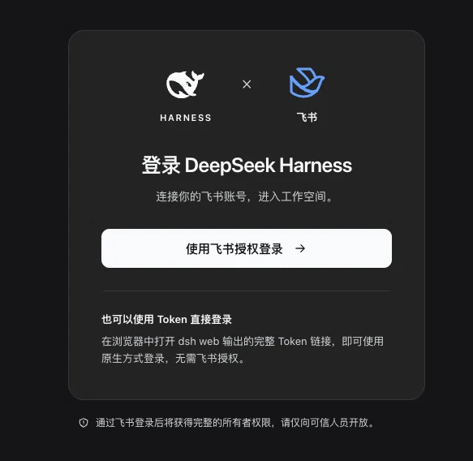

# DSH 飞书 OAuth

为 DeepSeek Harness 提供飞书登录的独立插件。在 dsh 0.2.3-alpha.2+ 上，登录成功后签发本插件签名的持久会话 Cookie，并通过 `connection.authentication.register()` 加入宿主认证注册表——与官方 Token / remote-connection provider 走同一条准入路径，官方 `"/"` 网关（扫码配对 / Token 登录）照常工作，飞书会话同样被放行进入主应用。不修改核心。[源码与问题反馈](https://github.com/lloydzhou/dsh-feishu-oauth) · [MIT 许可证](<LICENSE>) · [安全说明](<SECURITY.md>) · [贡献与设置集成参考](<SETTINGS-INTEGRATION.md>)。

> **仅供可信人员共享使用。** 所有获得飞书应用授权且用户信息有效的用户均获得同一个 DSH owner 的完整权限。没有独立账户、用户或租户白名单、逐用户审计或撤销机制；请通过飞书应用可用范围限制人员，并限制网络访问。

## 登录效果



## 安装与配置

需要 Node.js >=24.9.0。在提供 `connection.authentication.register()` 的 DSH（0.2.3-alpha.2+）上使用 provider 模式；更旧的版本（>=0.2.1-rc.3）回退到旧的原生 Cookie 交换（`authorizeIndex`），且需要 `rootPage: true` 才提供根路径登录墙。不等同所有版本或真实飞书端到端验证。

```sh
git clone https://github.com/lloydzhou/dsh-feishu-oauth.git
cd dsh-feishu-oauth
npm ci
npm run build:client
dsh plugin --profile web add .
```

1. 在 Plugins 页面启用本插件 bundle，保持 `feishu-oauth` 插件行加载。配置中的“启用飞书登录”默认关闭，与 bundle 总开关不同。
2. 使用 DSH 启动时打印的原生 token URL 登录，打开 Plugins → 已安装插件 → 本插件配置页面。
3. 在飞书应用中限定可信人员的可用范围，并登记卡片显示的精确回调地址：配置了 `publicUrl` 时为其根地址加 `/auth/feishu/callback`，否则为浏览器当前 origin 加同一路径。
4. 输入 App ID 和 App Secret **原始值**（不是环境变量名），按需填写 `publicUrl`，启用并保存。首次配置需填写 Secret；之后密码框留空表示保留现值。保存成功或配置冲突后重新载入表单再编辑。

| 字段 | 默认值 | 说明 |
| --- | --- | --- |
| `enabled` | `false` | 启用 OAuth 路由 |
| `appId` | 空 | 飞书 App ID |
| `appSecret` | 空 | 原始 App Secret；读取时脱敏，表单留空保留现值 |
| `publicUrl` | 空 | 可选公开访问基址，只接受 http(s) 根地址；留空沿用当前请求地址 |

### 公开访问基址（`publicUrl`）

`publicUrl` 用于把 OAuth 面向浏览器的地址固定为管理员配置的公开基址。留空时完全沿用原有行为：按每次请求的可信 Host 和原生 listener 协议组合出 origin。填写后，以下位置使用该基址：

- 飞书授权请求和 token 交换中的 `redirect_uri`；
- OAuth 临时 Cookie 的命名、`Secure` 属性和 state 绑定；
- 成功登录时通过原生 `authenticatedUrl()` / `authorizeIndex()` 换取 Cookie 的基址；
- 设置卡片中只读回调地址的展示。

原生 Token 恢复入口 `/?token=...` 仍原样委托给 DSH，不受 `publicUrl` 影响；原生 Cookie 的签名、Host 信任和 listener 协议也不由本插件改变。`publicUrl` 来自已保存配置而不是请求参数，不会成为开放重定向目标。

`publicUrl` **不会**把公开域名加入原生 Host 信任列表，也不会修改 `ctx.connection.trustedHosts`。原生把两者明确分开：`dsh --profile web --public-url ...` 的帮助文本明确写着 “grants no trust”；准入由 `--trusted-host <host[:port]>` 或 web profile 中 `client-connection` 行的 `trustedHosts` 配置决定。若反向代理保留真实 Host，宿主必须已经配置该精确 authority；否则请求会在进入 OAuth 逻辑前被拒绝（403），配置 `publicUrl` 也不能绕过。该信任配置需要宿主侧修改并重新加载/重启；插件没有安全的公开运行时 API 增删 authority，也不会自动添加。注意 `trustedHosts` 是部署级 `/api` Host/Origin 准入列表，不是 OAuth 专用白名单；加入公开域名不会跳过 Cookie/token 认证或同源检查，但会让该 authority 与整个 Web UI/API 一样通过 Host fence。反过来说，若代理保留真实 Host 且 DSH 已信任它，请求地址本身已经等于公开基址，`publicUrl` 只在需要显式固定 origin（例如 Host 被改写或存在多个可信地址）时才需要。

校验只接受 `http(s)` 的根 origin（例如 `https://dsh.example` 或 `http://192.0.2.10:3080`），拒绝凭据、查询串、片段、空白/控制字符和反斜杠。原生 web-app 的 `--public-url` 允许 `host/prefix`；本插件的登录路由固定在根挂载，因此这里**不支持路径前缀**：插件注册 `/auth/feishu/login`、`/auth/feishu/start` 和 `/auth/feishu/callback`（`rootPage: true` 时另有 `/`），成功页也返回 `/`，因此 `https://dsh.example/dsh` 之类的地址无效。表单会在保存前校验；若手工修改 profile 写入无效值，激活会失败并撤下 OAuth 路由，宿主原生登录不受影响。填写后浏览器也必须通过该基址访问 DSH；否则临时 Cookie 不会带回回调，登录会安全失败。

密码框始终空白载入，成功保存后清空；界面不显示 Secret 是否已配置。脱敏和密码遮罩不等于加密：**App Secret 以明文存储于本机 profile 配置**，请保护配置文件及备份。

允许 HTTP 访问 DSH，但浏览器提交设置时的 App Secret、原生登录凭据和会话流量均没有传输加密。飞书 provider 请求始终使用 HTTPS，这不保护浏览器到 DSH 的 HTTP 链路。建议使用原生 HTTPS。`publicUrl` 只固定 OAuth 面向浏览器的基址，不改变原生 Host 信任、listener 协议或原生 Cookie 的安全属性，也不单独构成对 TLS 终止反向代理的支持。浏览器实际访问的地址必须与飞书登记的回调一致。

## 登录与恢复

### 路由与宿主兼容

| 宿主 | `"/"` 归属 | 飞书登录入口 |
| --- | --- | --- |
| dsh 0.2.3-alpha.2+（有 remote-connection 官方网关） | 官方网关（扫码/配对/Token 登录照常） | `/auth/feishu/login` |
| 更旧版本（无 remote-connection） | 本插件（需 `rootPage: true`） | `/` 或 `/auth/feishu/login` |

默认**不占用** `/`：dsh 0.2.3-alpha.2 引入的 remote-connection 官方网关注册了同一 exact 路由，重复注册会让官方组件激活失败。插件注册 `/auth/feishu/login`（登录卡片页）、`/auth/feishu/start` 与 `/auth/feishu/callback`（路径不变，飞书应用的 redirect_uri 配置无需修改）。登录页支持中英文、窄屏及系统深色模式，不加载外部字体、图片或脚本，样式经固定 CSP 哈希授权。登录成功后签发 14 天持久会话 Cookie（HttpOnly/SameSite=Lax，HTTPS 下 Secure），成功页零延迟 meta refresh 返回同源 `/`——官方网关随后的准入请求由本插件的 authentication provider 认可，直接进入主应用。`rootPage: true` 时插件额外注册 `/` 作为登录墙（旧宿主需要；新宿主上若 `/` 已被占用则仅跳过并告警；legacy 宿主上 `/?token=...` 恢复与原生 Cookie admit 委托给宿主）。匿名访问 `/index.html` 可能得到原生 401。API 和 WebSocket 继续使用宿主认证。

OAuth 关闭或应用凭据缺失时不注册登录路由。设置集成捕获到激活或清理异常时记录固定脱敏警告；并非所有缺失或错误配置都会产生警告。保存成功不证明飞书凭据或回调登记有效。相关配置变更会撤下 OAuth 路由、取消待登录请求，清理后重新挂载；关闭或卸载恢复原生入口。

**飞书撤权或退出不会自动使已签发的会话 Cookie 失效**（有效期 14 天，由本插件签名校验）；关闭插件后 Cookie 无人认可即失效。保留宿主原生登录方式；不要将本插件当作多用户权限系统。

## 保护措施与限制

- state 单次使用、绑定浏览器，有效期 300 秒，最多 256 个待处理 state；最多同时进行 16 个 provider 交换流程。这些是单进程容量限制，**不是按 IP 限流，也不是 DoS 防护**。
- 使用 S256 PKCE、固定 HTTPS provider 地址、禁止跟随 provider 重定向、请求超时及响应大小限制。临时 Cookie 为 HttpOnly/SameSite=Lax，有效公开基址为 HTTPS 时带 Secure。
- `publicUrl` 只接受已保存配置中的 http(s) 根 origin，不能包含凭据、查询串、片段或路径；OAuth 重定向目标完全来自配置而非请求参数。它不会绕过原生 Host 信任，也不会改变 `/?token=...` 原生恢复或原生 Cookie 的签发与校验。浏览器必须通过配置的基址访问，否则临时 Cookie 不会返回回调。
- 原生启动 token 不进入页面、浏览器重定向、外部 HTTP 请求或日志；插件不读取签名密钥。错误仅包含固定阶段 `TOKEN` 或 `USERINFO`，以及已收到的 HTTP 状态和飞书数字错误码，不回显 provider 正文或凭据。
- `TOKEN/HTTP_400/CODE_20002` 表示飞书拒绝应用凭据；只有 `TOKEN` 表示未收到 token 接口响应头。排查后从首页重新登录，不刷新已消耗授权码的回调页。
- state 只在进程内存中保存；进程退出或配置更新会使待登录失效。同一浏览器发起新登录会覆盖旧临时绑定。绕过 Connection 的自定义 listener 不在保护范围内。

配置卡片随 DSH 界面语言切换中英文；登录、成功及错误页面按浏览器 `Accept-Language` 选择中英文，默认英文。原生 token 恢复响应由 DSH 负责。

## 开发与验证

```sh
npm ci
npm run build:client
npm run check
npm test
npm pack --dry-run --ignore-scripts
```

### 目录结构

```text
src/server/   插件入口、OAuth、登录页面及设置生命周期
src/client/   配置卡片与表单逻辑源码
dist/client.js 浏览器 bundle（生成并提交）
scripts/      客户端构建脚本
test/         单元测试及可选的原生模块兼容测试
locale/       对外导出的中英文 JSON
```

服务端直接运行 ESM 源码；[客户端入口](<src/client/index.js>)由[构建脚本](<scripts/build-client.mjs>)打包到[浏览器产物](<dist/client.js>)。npm 包仅包含服务端、浏览器产物、语言 JSON、DSH patch 和说明文档，不包含客户端源码、构建脚本或测试。公开导出保持为 `.`、`./client`、`./locale/*.json` 和 `./package.json`；CI 重建后检查浏览器产物无差异。

esbuild 固定版本并由锁文件锁定依赖。原生模块兼容测试、设置保存语义和资源 API 要求见[贡献与设置集成参考](<SETTINGS-INTEGRATION.md>)。模拟及提取模块测试不等于真实浏览器或飞书授权往返验收；升级 DSH 后应重新验证。安全问题请按[安全说明](<SECURITY.md>)私密报告，勿在公开 issue 中提交凭据。

## 飞书协议参考

授权端点使用 `https://accounts.feishu.cn/open-apis/authen/v1/authorize`，按其文档中的 PKCE 配对说明，通过 `https://open.feishu.cn/open-apis/authen/v2/oauth/token` 的 JSON 请求体换取 token。保留 S256 challenge 与 verifier，不自动降级或重试已用授权码。v2 被标为历史版本；迁移 v3 前需验证授权端点的 PKCE 兼容性。飞书错误码 `20049` 表示 PKCE 校验失败。

- [授权码与 PKCE](https://open.feishu.cn/document/common-capabilities/sso/api/obtain-oauth-code.md)
- [OAuth v2 token 与 v3 迁移说明](https://open.feishu.cn/document/uAjLw4CM/ukTMukTMukTM/authentication-management/access-token/get-user-access-token.md)
- [用户信息](https://open.feishu.cn/document/server-docs/authentication-management/login-state-management/get.md)
